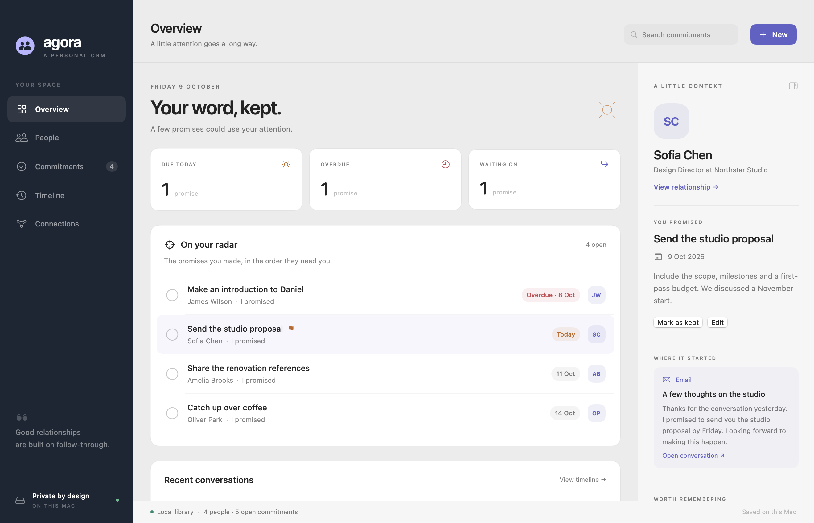

# Agora

A native macOS personal CRM for the people in your life and the promises you make to them.

Agora runs on your Mac, without an account or a cloud database. Its SwiftUI app, Outlook add-in and local MCP helper share a SQLite library.



## Install

Download the latest disk image from [GitHub Releases](https://github.com/acousland/Agora/releases/latest), open it and drag **Agora.app** into Applications. Requires **macOS 14 or later on Apple silicon**. Sparkle checks for future releases; use **Agora → Check for Updates…** for a manual check.

The first release is Developer ID signed. See each release's notes for its notarisation status.

## Keep your word

- **People** keeps names, email addresses, companies, roles, tags and personal notes.
- **Commitments** distinguishes promises you made from promises someone made to you. Record a deadline, priority, notes and the source conversation; mark it kept, reopen it or cancel it.
- **Overview** brings overdue promises, today's commitments and recent conversations together.
- **Timeline** records emails, meetings, calls, messages and notes.
- **Connections** walks through Outlook and MCP setup, JSON import/export and consistent SQLite backups.

Keyboard shortcuts: **⌘N** new commitment, **⇧⌘N** new person, **⌘L** log interaction, **⌘R** refresh.

## Outlook for Mac

Open **Connections** in Agora:

1. Choose **Set up local HTTPS**. This generates a per-Mac localhost certificate and trusts it in your login Keychain. macOS may request confirmation. The HTTPS receiver binds only to `127.0.0.1:3848`.
2. Save the manifest, open [Microsoft's add-in installer](https://aka.ms/olksideload), then select **My add-ins → Add a custom add-in → Add from File**. Choose the saved XML file.
3. Open an email in Outlook for Mac, choose **Apps → Agora / Save to Agora**, then paste the pairing key from Agora's Connections screen.
4. Select the person, optionally add one or more promises, and save. Keep Agora open during capture.

The add-in captures the email you explicitly save, not your whole inbox. It stores the plain-text body, subject, date and message ID. Received and sent messages are supported; compose drafts and automatic background mailbox sync are not. Repeated capture of the same message and promise title is idempotent; new promises may be added to an already-saved message.

Microsoft 365 / supported Exchange mailboxes and an organisation policy permitting custom add-ins are required. Outlook installation and real mailbox validation require your signed-in account. See the [Outlook guide](docs/OUTLOOK.md) and [Microsoft's sideloading instructions](https://learn.microsoft.com/en-us/office/dev/add-ins/outlook/sideload-outlook-add-ins-for-testing).

## Local MCP

The bundled `AgoraMCP` executable is a stdio MCP server, like Mondrian's local helper. The Mac app does not need to be running. Configure your AI client with:

```json
{
  "mcpServers": {
    "agora-local": {
      "command": "/Applications/Agora.app/Contents/MacOS/AgoraMCP",
      "args": []
    }
  }
}
```

It exposes ten tools for discovering people, recording interactions, capturing emails and managing commitments. [Full connection guide and examples](docs/MCP.md).

## Your data

The default library is `~/Library/Application Support/Agora/agora.sqlite`. The Outlook pairing key and local certificate are stored privately beside it. Set `AGORA_DATA_DIR` on the app or MCP helper for a separate library. Sample data is never added to the default library. SQLite uses WAL and foreign keys; mutations are transactional and edits require the latest revision. The app refreshes changes from other writers every three seconds while active.

JSON export contains the full library, including email bodies. JSON import adds records atomically and rejects duplicate IDs or email addresses; it never silently replaces existing data. Use a new library directory to restore an entire export. The database backup button uses SQLite's backup API and includes committed WAL changes. Keep backups somewhere appropriate for your personal information.

The CRM works offline. Outlook's Office.js runtime, add-in installation and Sparkle checks require network access. A connected AI client can read records through MCP and may send them to its model provider according to that client's settings. Agora itself has no analytics or cloud CRM service.

## Build and test

Install Xcode or its Swift command-line tools, then:

```sh
swift test
python3 scripts/smoke-mcp.py
scripts/build-app.sh
open dist/Agora.app
```

No Node, Electron, Python runtime or external database is needed by the installed app. Python 3 is used only by development and release scripts. SQLite is provided by macOS. Dependencies are pinned in `Package.resolved`: the official Swift MCP SDK and Sparkle.

For isolated sample data:

```sh
AGORA_DATA_DIR=/tmp/agora-demo dist/Agora.app/Contents/MacOS/Agora --demo
```

## Release from a Mac

Releases are built locally, without GitHub Actions. The public source, releases and Sparkle feed are in this repository. Private signing keys stay in the login Keychain.

1. Update `Assets/version` and `RELEASE_NOTES.md`; commit and push `main`.
2. Run `AGORA_NOTARY_PROFILE=<saved-profile> scripts/publish-release.sh 1.0.0`.

The script tests the database and MCP helper; builds and Developer ID signs the app and Sparkle helpers; notarises and staples the app and DMG when credentials exist; signs the update with Agora's Sparkle Ed25519 key; uploads the DMG, checksum and Outlook manifest to GitHub Releases; downloads and compares the public installer; and commits the appcast only after verifying the published download. `AGORA_ALLOW_UNNOTARIZED=1` explicitly allows a signed release when no notary profile exists; the release notes disclose that status.

`AGORA_SIGNING_IDENTITY`, `AGORA_NOTARY_PROFILE`, `AGORA_CONFIGURATION`, `AGORA_VERSION` and `AGORA_BUILD_NUMBER` provide local build overrides. Initial Sparkle key setup is `.build/artifacts/sparkle/Sparkle/bin/generate_keys --account agora`; only the public key belongs in `Assets/sparkle-public-key`.

MIT licensed. Copyright © 2026 Aaron Cousland.
